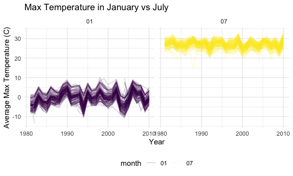
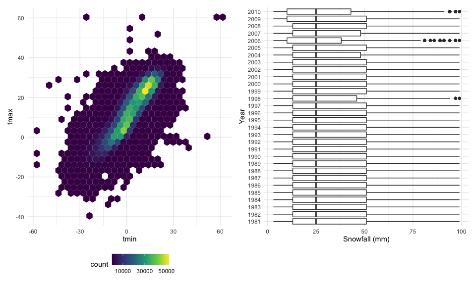
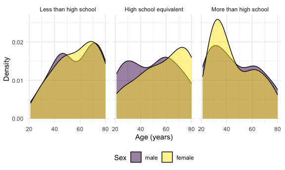
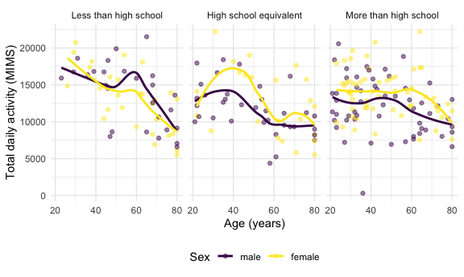
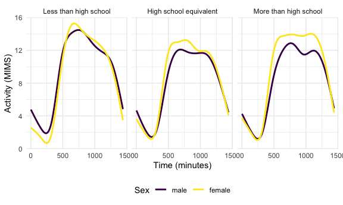
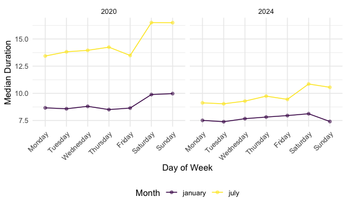

p8105_hw3_lah2227
================
Lauren Holley
2026-10-16

``` r
library(tidyverse)
library(p8105.datasets)
library(patchwork)

data("ny_noaa")

knitr::opts_chunk$set(
  fig.width = 6,
  fig.asp = .6,
  out.width = "90%"
)

theme_set(theme_minimal() + theme(legend.position = "bottom"))

options(
  ggplot2.continuous.colour = "viridis",
  ggplot2.continuous.fill = "viridis"
)

scale_colour_discrete = scale_colour_viridis_d
scale_fill_discrete = scale_fill_viridis_d
```

## Problem 1

#### Cleaning the data + basic intepretation

``` r
ny_noaa_df =
  ny_noaa |>
  janitor::clean_names() |>
  separate(date, into = c("year", "month", "day"), sep = "-") |>
  mutate(
  tmax = as.numeric(tmax) / 10,
  tmin = as.numeric(tmin) / 10,
  prcp = prcp / 10
)
```

``` r
ny_noaa_df |>
  count(snow) |>
  arrange(desc(n))
```

    ## # A tibble: 282 × 2
    ##     snow       n
    ##    <int>   <int>
    ##  1     0 2008508
    ##  2    NA  381221
    ##  3    25   31022
    ##  4    13   23095
    ##  5    51   18274
    ##  6    76   10173
    ##  7     8    9962
    ##  8     5    9748
    ##  9    38    9197
    ## 10     3    8790
    ## # ℹ 272 more rows

The most common value for snowfall was 0mm. This makes sense, as a
majority of the days in a year don’t typically have snow. More common
values were also 25mm, 13mm, and 51mm which correspond to about an inch,
half an inch, and two inches of snow. This is all logical for snowfall
measurements, as they are typically measured in rounded inch counts.

#### Plot of average temperature max

``` r
ny_noaa_df |>
  filter(month == "01" | month == "07") |>
  group_by(id, year, month) |>
  summarize(
    mean_tmax = mean(tmax, na.rm = TRUE)
  ) |>
  ggplot(aes(x = as.numeric(year), y = mean_tmax, group = id, color = month)) +
  geom_line(alpha = 0.2) +
  facet_grid(. ~ month) +
  theme_minimal() +
  labs(
    title = "Max Temperature in January vs July",
    x = "Year",
    y = "Average Max Temperature (C)"
  ) +
  theme(legend.position = "bottom")
```

    ## `summarise()` has regrouped the output.
    ## ℹ Summaries were computed grouped by id, year, and month.
    ## ℹ Output is grouped by id and year.
    ## ℹ Use `summarise(.groups = "drop_last")` to silence this message.
    ## ℹ Use `summarise(.by = c(id, year, month))` for per-operation grouping
    ##   (`?dplyr::dplyr_by`) instead.

    ## Warning: Removed 5932 rows containing missing values or values outside the scale range
    ## (`geom_line()`).



Average maximum temperature was consistently higher in the month of July
over the years. This is logical with the typical seasonality. January
had more variation in max temperatures over the years in comparison to
July. It seems like there are a couple of outliers: one that’s about -13
degrees around January 1982 and one that’s about 14 degrees around July
1988.

#### Plots of tmax/tmin and snowfall between 0 and 100mm

``` r
ggp_tmax_tmin = 
  ny_noaa_df |>
  ggplot(aes(x = tmin, y = tmax)) +
  geom_hex()

ggp_snow =
  ny_noaa_df |>
  filter(snow > 0, snow < 100) |>
  ggplot(aes(x = snow, y = factor(year))) +
  geom_boxplot() +
  labs(x = "Snowfall (mm)", y = "Year")

ggp_tmax_tmin + ggp_snow
```

    ## Warning: Removed 1136276 rows containing non-finite outside the scale range
    ## (`stat_binhex()`).



## Problem 2

#### Merging and cleaning the datasets

``` r
demo_df =
  read_csv(
    "data/nhanes_demo.csv", skip = 4, na = "NA") |>
  janitor::clean_names() |>
  mutate(
    sex = case_match(
      sex,
      1 ~ "male",
      2 ~ "female"),
    education = case_match(
      education,
      1 ~ "Less than high school",
      2 ~ "High school equivalent",
      3 ~ "More than high school"
    ),
    sex = factor(sex, levels = c("male", "female")),
education = factor(
  education,
  levels = c(
    "Less than high school",
    "High school equivalent",
    "More than high school"
  ))) |>
  filter(age >= 21) |>
  drop_na(sex, age, bmi, education)
```

    ## Rows: 250 Columns: 5
    ## ── Column specification ────────────────────────────────────────────────────────
    ## Delimiter: ","
    ## dbl (5): SEQN, sex, age, BMI, education
    ## 
    ## ℹ Use `spec()` to retrieve the full column specification for this data.
    ## ℹ Specify the column types or set `show_col_types = FALSE` to quiet this message.

    ## Warning: There was 1 warning in `mutate()`.
    ## ℹ In argument: `sex = case_match(sex, 1 ~ "male", 2 ~ "female")`.
    ## Caused by warning:
    ## ! `case_match()` was deprecated in dplyr 1.2.0.
    ## ℹ Please use `recode_values()` instead.

``` r
accel_df =
  read_csv(
    "data/nhanes_accel.csv") |>
  janitor::clean_names() |>
  pivot_longer(
  min1:min1440,
  names_to = "minute",
  names_prefix = "min",
  values_to = "mims"
  ) |>
  mutate(minute = as.numeric(minute))
```

    ## Rows: 250 Columns: 1441
    ## ── Column specification ────────────────────────────────────────────────────────
    ## Delimiter: ","
    ## dbl (1441): SEQN, min1, min2, min3, min4, min5, min6, min7, min8, min9, min1...
    ## 
    ## ℹ Use `spec()` to retrieve the full column specification for this data.
    ## ℹ Specify the column types or set `show_col_types = FALSE` to quiet this message.

``` r
nhanes_df =
  left_join(demo_df, accel_df, by = "seqn")
```

#### Demographic Table

``` r
demo_df |>
  group_by(sex, education) |>
  summarize(
    n = n()
  ) |>
  pivot_wider(names_from = sex, values_from = n) |>
  knitr::kable()
```

    ## `summarise()` has regrouped the output.
    ## ℹ Summaries were computed grouped by sex and education.
    ## ℹ Output is grouped by sex.
    ## ℹ Use `summarise(.groups = "drop_last")` to silence this message.
    ## ℹ Use `summarise(.by = c(sex, education))` for per-operation grouping
    ##   (`?dplyr::dplyr_by`) instead.

| education              | male | female |
|:-----------------------|-----:|-------:|
| Less than high school  |   27 |     28 |
| High school equivalent |   35 |     23 |
| More than high school  |   56 |     59 |

#### Visualization of Genders vs Education

``` r
demo_df |>
  ggplot(aes(x = age, fill = sex)) +
  geom_density(alpha = 0.5) +
  facet_grid(. ~ education) +
  labs(x = "Age (years)", y = "Density", fill = "Sex")
```



About half of the study group falls within the more than high school
category, with the other half more relatively evenly split between the
other two education groups. There are slightly less females than men in
the study. For women in the more than high school education group, the
age distribution peaks around 21 to 40. The groups with the less than
high school education and high school equivalent generally tend to be
older.

#### Aggregation, Total Activity + Age Plot

``` r
total_activity_df =
  nhanes_df |>
  group_by(seqn, sex, age, education) |>
  summarize(
    total_activity = sum(mims)
  )
```

    ## `summarise()` has regrouped the output.
    ## ℹ Summaries were computed grouped by seqn, sex, age, and education.
    ## ℹ Output is grouped by seqn, sex, and age.
    ## ℹ Use `summarise(.groups = "drop_last")` to silence this message.
    ## ℹ Use `summarise(.by = c(seqn, sex, age, education))` for per-operation
    ##   grouping (`?dplyr::dplyr_by`) instead.

``` r
total_activity_df |>
  ggplot(aes(x = age, y = total_activity, color = sex)) +
  geom_point(alpha = 0.5) +
  geom_smooth(se = FALSE) +
  facet_grid(. ~ education) +
  labs(
    x = "Age (years)",
    y = "Total daily activity (MIMS)",
    color = "Sex"
  )
```

    ## `geom_smooth()` using method = 'loess' and formula = 'y ~ x'



This plot makes a lot of sense – it shows a relationship where as the
age of an individual increases, their daily activity decreases. This is
pretty typical as people become less mobile as they age. The less than
high school education group has the steepest decline, with the highest
activity levels of all education groups around age 21 and similarly low
activity levels around age 80. Females with high school equivalent
educations had a peak total daily activity around age 40.

#### Time Course Education Level Plots

``` r
nhanes_df |>
  ggplot(aes(x = minute, y = mims, color = sex)) +
  geom_smooth(se = FALSE) +
  facet_grid(. ~ education) +
  labs(
    x = "Time (minutes)",
    y = "Activity (MIMS)",
    color = "Sex"
  )
```

    ## `geom_smooth()` using method = 'gam' and formula = 'y ~ s(x, bs = "cs")'



In all education levels, females generally had a slightly higher level
of activity in the middle of the day. Activity reached its lowest during
the night hours, which makes sense given the fact that a majority of
people are sleeping. Individuals with less than high school educations
reached activity peaks at about 600 minutes into the day, with those in
the other two education groups having more stable activity distributions
from around 600 minutes to around 1100 minutes.

## Problem 3

#### Merging and cleaning the data

``` r
jan_2020_df =
  read_csv(
    "data/jan_2020_citi.csv") |>
  janitor::clean_names() |>
  mutate(year = 2020, month = "january")
```

    ## Rows: 12420 Columns: 7
    ## ── Column specification ────────────────────────────────────────────────────────
    ## Delimiter: ","
    ## chr (6): ride_id, rideable_type, weekdays, start_station_name, end_station_n...
    ## dbl (1): duration
    ## 
    ## ℹ Use `spec()` to retrieve the full column specification for this data.
    ## ℹ Specify the column types or set `show_col_types = FALSE` to quiet this message.

``` r
jul_2020_df =
  read_csv(
    "data/july_2020_citi.csv") |>
  janitor::clean_names() |>
  mutate(year = 2020, month = "july")
```

    ## Rows: 21048 Columns: 7
    ## ── Column specification ────────────────────────────────────────────────────────
    ## Delimiter: ","
    ## chr (6): ride_id, rideable_type, weekdays, start_station_name, end_station_n...
    ## dbl (1): duration
    ## 
    ## ℹ Use `spec()` to retrieve the full column specification for this data.
    ## ℹ Specify the column types or set `show_col_types = FALSE` to quiet this message.

``` r
jan_2024_df =
  read_csv(
    "data/jan_2024_citi.csv") |>
  janitor::clean_names() |>
  mutate(year = 2024, month = "january")
```

    ## Rows: 18861 Columns: 7
    ## ── Column specification ────────────────────────────────────────────────────────
    ## Delimiter: ","
    ## chr (6): ride_id, rideable_type, weekdays, start_station_name, end_station_n...
    ## dbl (1): duration
    ## 
    ## ℹ Use `spec()` to retrieve the full column specification for this data.
    ## ℹ Specify the column types or set `show_col_types = FALSE` to quiet this message.

``` r
jul_2024_df =
  read_csv(
    "data/july_2024_citi.csv") |>
  janitor::clean_names() |>
  mutate(year = 2024, month = "july")
```

    ## Rows: 47156 Columns: 7
    ## ── Column specification ────────────────────────────────────────────────────────
    ## Delimiter: ","
    ## chr (6): ride_id, rideable_type, weekdays, start_station_name, end_station_n...
    ## dbl (1): duration
    ## 
    ## ℹ Use `spec()` to retrieve the full column specification for this data.
    ## ℹ Specify the column types or set `show_col_types = FALSE` to quiet this message.

``` r
citi_df =
  bind_rows(jan_2020_df, jul_2020_df, jan_2024_df, jul_2024_df) |>
  mutate(
    month = factor(month, levels = c("january", "july")),
    weekdays = factor(
      weekdays,
      levels = c(
        "Monday", "Tuesday", "Wednesday", "Thursday",
        "Friday", "Saturday", "Sunday"
      )
    )
  )
```

The resulting `citi_df` dataset has 99485 rows and 9 columns. It has
variable names: ride_id, rideable_type, weekdays, duration,
start_station_name, end_station_name, member_casual, year, month. This
dataset combines data from January and July of both 2020 and 2024. Each
row represents one ride, and the data overall represents 1% of rides
with a total duration less than 4 hours during the listed time frames.

#### Table for Casual vs Citi members

``` r
citi_df |>
  group_by(year, month, member_casual) |>
  summarize(
    n = n()
  ) |>
  pivot_wider(
    names_from = member_casual, values_from = n) |>
  knitr::kable()
```

    ## `summarise()` has regrouped the output.
    ## ℹ Summaries were computed grouped by year, month, and member_casual.
    ## ℹ Output is grouped by year and month.
    ## ℹ Use `summarise(.groups = "drop_last")` to silence this message.
    ## ℹ Use `summarise(.by = c(year, month, member_casual))` for per-operation
    ##   grouping (`?dplyr::dplyr_by`) instead.

| year | month   | casual | member |
|-----:|:--------|-------:|-------:|
| 2020 | january |    984 |  11436 |
| 2020 | july    |   5637 |  15411 |
| 2024 | january |   2108 |  16753 |
| 2024 | july    |  10894 |  36262 |

There are a higher number of rides for members of Citi Bike versus
casual users. Casual riders had a lower number of rides, which is likely
the reason for them not needing memberships, so this makes sense.
Additionally, there are higher rates of usage for both member types
during the July months versus the January months, likely due to nicer
weather in the summer.

#### Table for 5 most popular starting locations

``` r
citi_df |>
  filter(year == 2024, month == "july") |>
  count(start_station_name) |>
  arrange(desc(n)) |>
  head(5) |>
  knitr::kable()
```

| start_station_name       |   n |
|:-------------------------|----:|
| Pier 61 at Chelsea Piers | 163 |
| University Pl & E 14 St  | 155 |
| W 21 St & 6 Ave          | 152 |
| West St & Chambers St    | 150 |
| W 31 St & 7 Ave          | 146 |

#### Plot on days of week and ride duration

``` r
citi_df |>
  group_by(year, month, weekdays) |>
  summarize(
    median_duration = median(duration, na.rm = TRUE)
  ) |>
  ggplot(aes(
    x = weekdays, 
    y = median_duration, 
    color = month, 
    group = month)) +
  geom_point(alpha = 0.5) +
  geom_line() +
  facet_grid(. ~ year) +
  labs(
    x = "Day of Week",
    y = "Median Duration",
    color = "Month"
  ) +
  theme(axis.text.x = element_text(angle = 45, hjust = 1))
```

    ## `summarise()` has regrouped the output.
    ## ℹ Summaries were computed grouped by year, month, and weekdays.
    ## ℹ Output is grouped by year and month.
    ## ℹ Use `summarise(.groups = "drop_last")` to silence this message.
    ## ℹ Use `summarise(.by = c(year, month, weekdays))` for per-operation grouping
    ##   (`?dplyr::dplyr_by`) instead.



Median duration across both years is lower in the January month than the
July month. The highest median duration for rides was on the weekends in
July 2020. Generally, Saturdays during all years and months were among
the highest median ride durations.

There were relatively few electric Citi Bikes in 2020, but many more are
available now. For data in 2024, make a figure that shows the impact of
month, membership status, and bike type on the distribution of ride
duration. Comment on your results.
